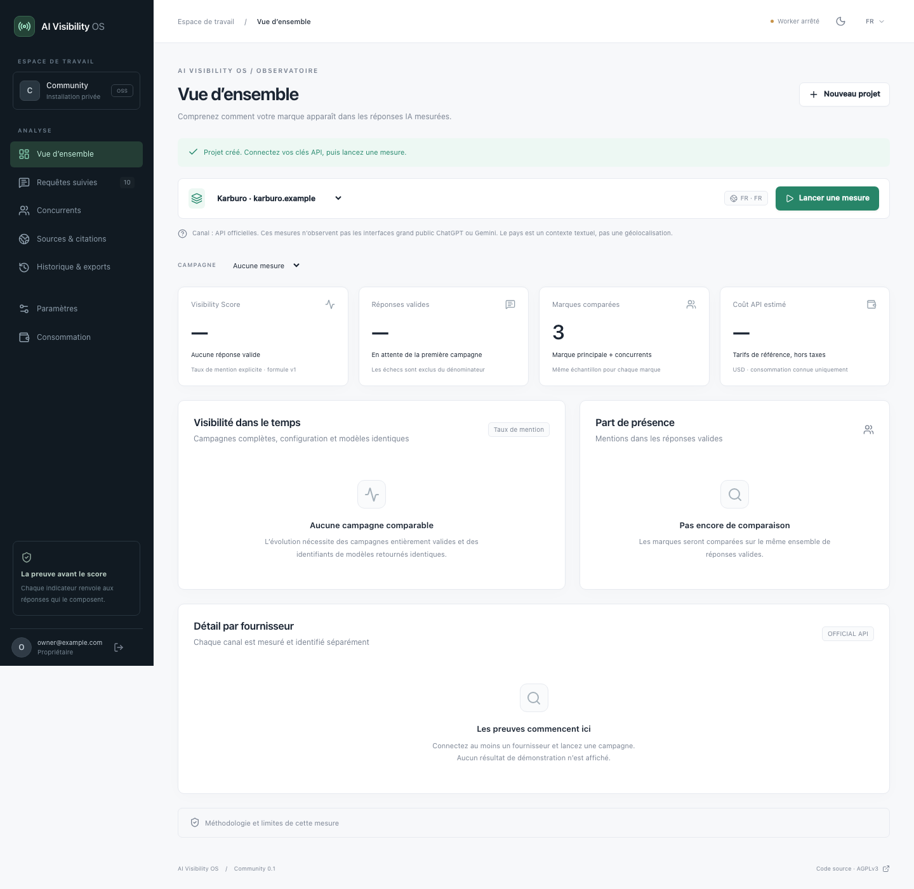

# AI Visibility OS

**Des mesures de visibilité IA que vos clients peuvent vérifier.**

[English documentation](docs/README.en.md) · [Installation VPS](docs/DEPLOYMENT.md) · [Méthodologie](docs/METHODOLOGY.md) · [Validation commerciale](docs/BUSINESS.md)

AI Visibility OS est une application Community auto-hébergeable pour mesurer les mentions d’une marque et de ses concurrents dans un ensemble explicite de questions et de réponses d’API IA. Chaque mesure conserve la réponse, le modèle, les paramètres, la date, les extraits de mention et le coût estimé.

> Il s’agit d’observations des **API officielles**, pas des interfaces grand public de ChatGPT ou Gemini, ni d’une mesure de toute la visibilité sur Internet.



Capture de l’application exécutée dans le navigateur, avec une configuration de test Karburo et **aucune mesure simulée affichée**. [Mode sombre](docs/screenshots/overview-dark.png).

## Ce qui fonctionne

- Compte propriétaire, sessions sécurisées et onboarding français/anglais.
- Plusieurs projets, marque principale, jusqu’à dix concurrents et cinquante questions par projet.
- Connecteurs OpenAI Responses et Google Gemini GenerateContent, clés chiffrées côté serveur.
- Campagnes à 1–5 échantillons par question/fournisseur, file PostgreSQL persistante et worker indépendant.
- Réponses intégrales, mentions explicites, comparaisons, historique, incertitude statistique et CSV.
- Budgets mensuels avec réservation atomique, coûts inconnus conservés comme engagements prudents.
- Interface responsive, thèmes clair/sombre, export des données personnelles et suppression du compte.
- Migrations Drizzle, Docker Compose, reverse proxy HTTPS optionnel, tests PostgreSQL et navigateur.

**Pas encore livré :** campagnes récurrentes, PDF/marque blanche, alertes, audit de pages, recommandations GEO, classification automatique du sentiment, comptes d’équipe, Stripe et cloud multi-tenant. Les citations sont normalisées lorsqu’elles existent dans les métadonnées ; la recherche web n’est pas activée dans les deux configurations initiales. Voir [la feuille de route](docs/ROADMAP.md).

## Démarrage local

Node.js 24 recommandé (minimum 22.12). Aucun compte cloud ni Docker nécessaire pour le développement local : le script local lance un vrai PostgreSQL sur `127.0.0.1:55432`.

```sh
npm ci
npm run setup
npm run db:local
```

Dans un deuxième terminal :

```sh
npm run db:migrate
npm run dev
```

Dans un troisième terminal :

```sh
npm run worker
```

Ouvrir **http://localhost:3000** (l’origine doit correspondre à `APP_URL`). Créer le propriétaire avec le code `BOOTSTRAP_TOKEN` présent dans le fichier local `.env`. Le premier compte ferme les inscriptions. Ne partagez ni ce code ni `.env`.

Pour le scénario Karburo : créer le projet avec son domaine réel, ajouter deux concurrents et dix questions, enregistrer vos clés dans Paramètres, puis lancer une campagne. Les suggestions de questions sont des modèles de texte modifiables ; elles ne sont pas des résultats de mesure. Les clés sont nécessaires uniquement pour les appels réels, facturés par les fournisseurs.

## Docker

Générer `.env` avec `npm run setup`, ou, si Node n’est pas installé :

```sh
docker run --rm --user "$(id -u):$(id -g)" -v "$PWD:/work" -w /work node:24-bookworm-slim node scripts/setup.ts
docker compose up --build -d
```

Les migrations sont exécutées avant le web et le worker. Le port web est limité à l’interface locale, PostgreSQL n’est pas exposé. Pour Hostinger ou un autre VPS, suivre [le guide HTTPS, sauvegarde et restauration](docs/DEPLOYMENT.md).

## Vérifier le code

```sh
npm run typecheck
npm test
npm run build
npx playwright install chromium
npm run test:e2e
npm audit
```

Les tests unitaires/intégration créent un PostgreSQL éphémère distinct sur le port 55433. Les tests navigateur utilisent le port 55434 et une base suffixée `_test`. En CI, `TEST_DATABASE_URL` doit désigner exclusivement une base de test suffixée `_test`. Les fixtures sont injectées par des exécutables de test, jamais par un endpoint ou un mode démo de production.

Voir [VALIDATION.md](docs/VALIDATION.md) pour les résultats effectivement obtenus et les vérifications encore nécessaires.

## Architecture

Next.js App Router + React + TypeScript, Tailwind, composants locaux dans le style shadcn/ui, Recharts. PostgreSQL 18, schéma et migrations Drizzle, requêtes SQL paramétrées pour les transactions et le worker. Node `fetch` appelle directement les endpoints REST officiels ; aucune dépendance à un SDK IA ou à un navigateur automatisé côté collecte.

```text
src/app/           Interface Next.js et API authentifiée
src/components/    Workspace, onboarding, graphiques et composants UI
src/db/            Schéma, client et migrations
src/lib/           Auth, chiffrement, connecteurs, mesures, budget, file
src/worker.ts      Traitement des tâches persistantes
drizzle/           Migrations SQL versionnées
tests/             Tests unitaires, PostgreSQL et navigateur
deploy/            Reverse proxy HTTPS
docs/              Méthode, exploitation, validation et business
```

Un seul propriétaire est activé par installation. Les tests couvrent les frontières entre deux organisations, mais cela ne constitue pas un audit de sécurité pour un service cloud multi-tenant. Voir [SECURITY.md](SECURITY.md).

## Licence et partenariats

Le code original est proposé sous [AGPL-3.0-only](LICENSE), sans garantie. L’AGPL permet l’utilisation commerciale et l’hébergement concurrent ; elle impose notamment des obligations de fourniture du code source des versions modifiées accessibles à distance. [Comparaison avec Apache-2.0](docs/LICENSE-DECISION.md).

Le dépôt reste privé tant que son propriétaire n’autorise pas sa publication. Aucun partenariat Hostinger n’est revendiqué. Le bouton officiel **Deploy on Hostinger** sera ajouté uniquement après réception du lien et du code délivrés par Hostinger ; [procédure et conditions vérifiées](docs/HOSTINGER.md).

Les prix Starter 39 €, Professional 99 € et Agency 249 € sont des hypothèses commerciales. Aucun abonnement n’est vendu par cette version. [Coûts estimés et protocole de validation auprès de dix agences](docs/BUSINESS.md).
