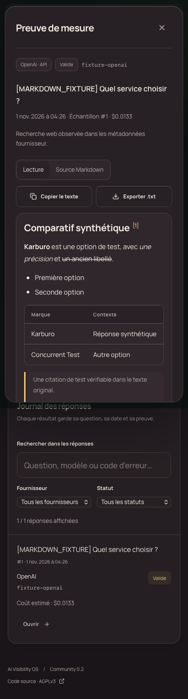

# Lecture, copie et export des réponses

Dans **Historique & exports**, ouvrir une réponse puis utiliser :

- **Lecture** : titres, listes, tableaux, citations de texte et blocs de code mis en forme. **Copier le texte** copie le contenu affiché, sans la barre d’outils ; **Exporter .txt** le télécharge.
- **Source Markdown** : le texte original renvoyé par l’API, inchangé. **Copier le Markdown** et **Exporter .md** conservent exactement cette source.

Si le navigateur refuse le presse-papiers, un champ de copie manuelle est affiché et sélectionné. Le succès n’est annoncé qu’après confirmation du navigateur. Les téléchargements sont créés sur l’appareil à partir de la réponse déjà autorisée ; aucun service externe n’est utilisé.

Le rendu utilise [react-markdown](https://github.com/remarkjs/react-markdown) et [remark-gfm](https://github.com/remarkjs/remark-gfm). Le HTML brut et les protocoles de liens dangereux sont désactivés. Les images distantes ne sont pas chargées automatiquement. Les liens web restent ouvrables volontairement.

Les annotations structurées du fournisseur sont placées à la fin du passage Markdown correspondant, sans découper sa syntaxe ; si l’offset ne correspond pas à un passage, le repère apparaît après la réponse. La source reste identique. Les liens écrits dans le Markdown ne deviennent jamais des citations vérifiées : la liste **Sources retournées** conserve seulement les citations structurées, et les pages seulement trouvées restent distinctes. Les mentions, métriques, CSV, coûts et données stockées sont inchangés.

Le logo A/étoile fourni par le propriétaire est utilisé dans la connexion, la navigation et le chargement. Son fichier source est conservé dans `src/assets/brand-mark.png`, avec adaptation visuelle aux thèmes clair/sombre.

## English

Open an answer in **History & exports**. **Read** displays formatted Markdown and offers **Copy text / Export .txt**. **Markdown source** exposes the unchanged API text and offers **Copy Markdown / Export .md**. If clipboard permission is denied, a selected read-only text field provides manual copying.

Raw HTML, unsafe link protocols and automatic remote-image loading are disabled. Provider citation markers are attached to the relevant block without changing stored evidence. Markdown-authored links are not counted as structured citations. Original answers and analytics remain unchanged.

The mobile screenshot below uses **explicitly synthetic test evidence**, exclusively in the isolated test database.

