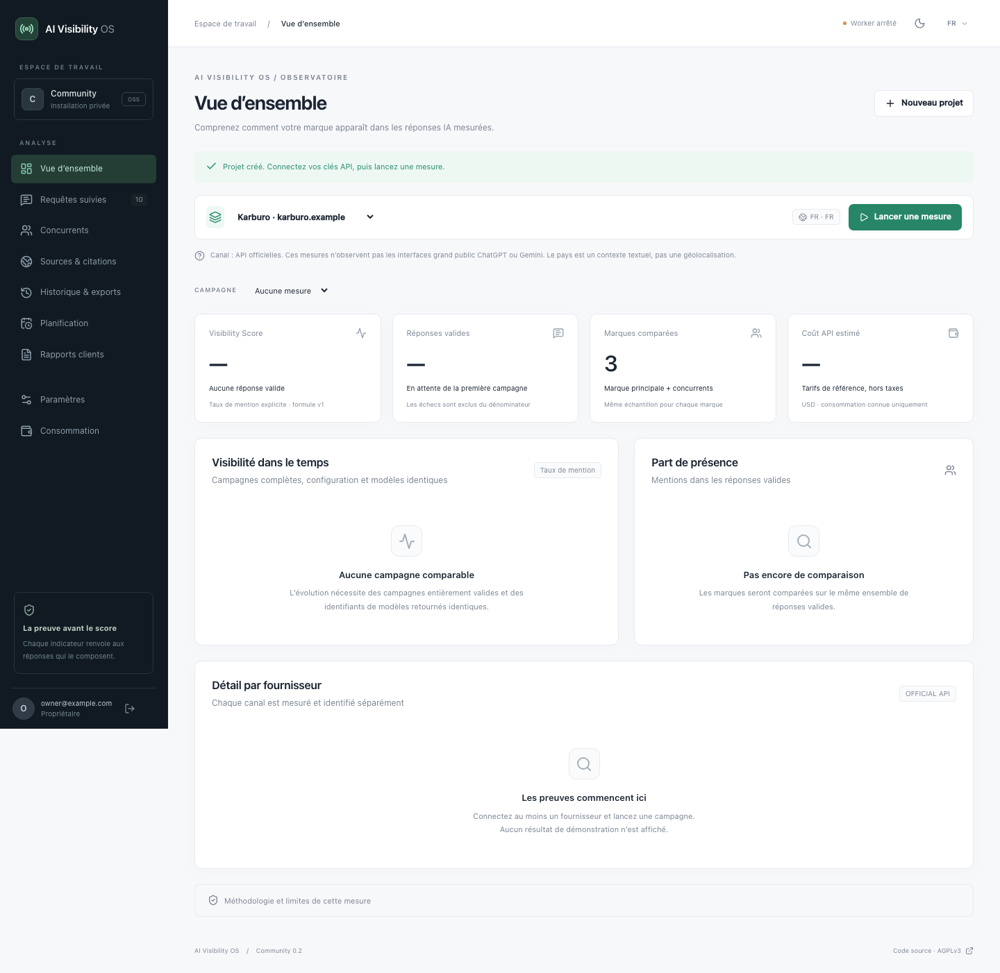

# AI Visibility OS

**Show clients how AI talks about their brand. With the answers to back it up.**

[Français](../README.md) · [Beta v0.2.0-beta.1](https://github.com/DissidentAI/AIVisibilityOS/releases/tag/v0.2.0-beta.1) · [Hostinger setup](HOSTINGER.md) · [Methodology](METHODOLOGY.md) · [AGPL-3.0-only](../LICENSE)

[](https://github.com/DissidentAI/AIVisibilityOS/actions/workflows/ci.yml)

AI Visibility OS is an open-source, self-hosted platform for small marketing agencies, GEO/AEO consultants and brands. Configure questions, measure brand and competitor mentions, inspect the evidence and prepare client reports in English, French or Simplified Chinese.

Your data lives in your installation. Bring your own API keys; questions are sent to the providers selected for the relevant analyses. API usage and hosting remain your responsibility. No AI Visibility OS subscription is required to use this Community edition.

> **Measurement scope:** this application observes an explicit sample of **official API responses**. These are not observations of consumer ChatGPT, Gemini or Kimi interfaces, or a measurement of a brand’s entire visibility on the Internet.

<picture>
  <source media="(prefers-color-scheme: dark)" srcset="screenshots/overview-dark.png">
  
</picture>

_Actual application UI with a Karburo test configuration; this view contains no simulated measurements. [Light theme](screenshots/overview-light.png) · [Dark theme](screenshots/overview-dark.png)._

## From questions to client reports

| What you need                | What the beta provides                                                                                                                                                                                              |
| ---------------------------- | ------------------------------------------------------------------------------------------------------------------------------------------------------------------------------------------------------------------- |
| **Measure presence**         | Multiple projects, up to 50 competitors and 50 questions per project, and 1–5 samples per question/provider. Each response retains provenance, time, parameters and estimated cost.                                 |
| **Verify a result**          | Direct authenticated evidence links from brands and questions; readable Markdown, search, filters, copying, text/Markdown/CSV exports. Citations are recorded only when actually supplied.                          |
| **Compare over time**        | Paginated history identifies comparable campaigns and explains exclusions. Compare new competitors against saved answers without another AI call while retaining the original scope.                                |
| **Organize research**        | Questions grouped by theme, intent and priority; saved views, bulk additions, AI-assisted question and competitor suggestions, editable project and saved scan settings.                                            |
| **Act on findings**          | GEO opportunities separate observations, hypotheses and suggested actions. Track GEO actions with frozen evidence. Run bounded public-page audits of your site and 10 competitors, with optional AI synthesis.      |
| **Deliver reports**          | PDF reports in English, French or Simplified Chinese, agency name/logo, compatible comparisons and a frozen JSON evidence bundle. Reports are generated on demand.                                                  |
| **Automate within a budget** | Daily/weekly campaigns, persistent jobs, parallel calls with provider/model ceilings and rate-limit cooldowns. Retry only failed answers within the same campaign while preserving successes and previous attempts. |

The interface includes light/dark themes, mobile navigation, browser drafts scoped to each account and an animation pause control. System reduced-motion preferences are respected. API keys are never stored in browser local storage.

### Supported providers

**OpenAI · Google Gemini · Kimi / Moonshot AI · OpenRouter · direct Xiaomi MiMo**

Every connector uses official APIs. The direct MiMo connector accepts your Xiaomi key without requiring OpenRouter. A web-search measurement mode is available for all five connectors, subject to model/account access; MiMo requires enabling its Web Search plugin. Retrieved pages remain distinct from explicit answer citations.

See the [provider guide](PROVIDERS.md) for model profiles, endpoints, reference pricing, limits and account requirements. Synthetic adapter tests check response contracts; they do not certify live access for every provider/model/account combination.

## Install with Docker

Requirements: **Git, Docker Engine or Docker Desktop, and Docker Compose v2**. These commands create a fresh local installation. For a public server, follow the [VPS setup with HTTPS](HOSTINGER.md).

```sh
git clone --branch v0.2.0-beta.1 --depth 1 https://github.com/DissidentAI/AIVisibilityOS.git
cd AIVisibilityOS

# Generate private settings; Node is not required on the host.
docker run --rm --user "$(id -u):$(id -g)" -v "$PWD:/work" -w /work \
  node:24-bookworm-slim node scripts/setup.ts

docker compose up --build -d --wait
```

Use a macOS/Linux shell, or WSL on Windows. The initial build downloads dependencies and takes a few minutes. Migrations finish before the web and worker start. Web access is bound to `127.0.0.1:3000`; PostgreSQL is not exposed externally.

1. Open [localhost:3000](http://localhost:3000).
2. Create the owner account using `BOOTSTRAP_TOKEN` from your local `.env` file. Registration closes after the first account.
3. Create a project with your brand, domain, description, competitors and questions.
4. Connect at least one API key in **Settings**, check the budget and launch a measurement.
5. Inspect the answers, mentions and costs, then generate your first report.

Installation does not trigger any AI generation and ships no demo results. Keep `.env` and its encryption key safe; never publish them. `APP_URL` must exactly match the browser origin.

### Hostinger and other VPS hosts

The [Hostinger guide](HOSTINGER.md) provides a standalone Compose template built from this beta tag, including PostgreSQL, migrations, web, worker and an HTTPS proxy. It covers domain setup, secret generation, Docker Manager import and operations. The [provider-independent deployment guide](DEPLOYMENT.md) also covers backups, restoration and upgrades.

**For Hostinger review:** [submission dossier](HOSTINGER-SUBMISSION.md) · [versioned Compose file](https://github.com/DissidentAI/AIVisibilityOS/blob/v0.2.0-beta.1/deploy/compose.hostinger.yaml) · [beta downloads](https://github.com/DissidentAI/AIVisibilityOS/releases/tag/v0.2.0-beta.1).

CI includes an integration test of the Docker template. Acceptance on a real Hostinger VPS and admission to the partner program remain separate. No partnership, catalogue listing or official “Deploy on Hostinger” button is claimed; a button will be added only after Hostinger supplies its official link.

## Understand the metrics

The **Visibility Score** is the explicit brand mention rate:

```text
100 × valid responses mentioning the brand / all valid responses
```

Failed, refused and truncated answers are excluded from the denominator. No valid answers means no score. Indicators expose their method and sample size. Wilson intervals describe uncertainty under independence assumptions; question selection and correlated answers limit interpretation.

A mention is not an endorsement. No ordinal ranking, sentiment or source is invented. Country is textual context, not geolocation. Editorial opportunities do not guarantee visibility improvements. Read the [full methodology](METHODOLOGY.md) before interpreting a change.

## Beta status and limitations

This release supports evaluation and early Community use, with **one owner per installation**. API keys are encrypted on the server, authorization is checked on the server and estimated costs are reserved before execution. Isolation tests exist; they do not replace an independent audit for a hosted multi-tenant service.

Not included: team accounts, SSO/MFA, Stripe billing, managed cloud hosting, automatic report delivery, outbound alerts or automatic sentiment classification. GEO action tracking is available; tracking actions from site audits remains future work. Costs are estimates based on available usage and recorded reference prices; provider quotas and terms still apply.

See the [changelog](../CHANGELOG.md), [validation record](VALIDATION.md), [security policy](../SECURITY.md) and [roadmap](ROADMAP.md). Release notes link the version to its source commit and CI results. Downloads include an SBOM, third-party notices and SHA-256 checksums.

## Develop and test

Inside the cloned repository, use **Node.js 24** (minimum 22.12). The local development PostgreSQL helper listens on `127.0.0.1:55432`; this path requires neither Docker nor a cloud service. Do not run it on ports already used by an active Docker installation.

```sh
npm ci
npm run setup
npm run db:local
```

Keep that terminal open. From the same folder in a second terminal:

```sh
npm run db:migrate
npm run dev
```

In a third terminal: `npm run worker`. Open [localhost:3000](http://localhost:3000) and follow the owner setup above. The local database uses development credentials and must never be exposed to the Internet.

```sh
npm run format:check
npm run typecheck
npm test
npm run build
npx playwright install chromium webkit
npm run test:e2e
npm audit
```

Tests use isolated PostgreSQL databases on ports 55433 and 55434, plus synthetic responses confined to tests. In CI, `TEST_DATABASE_URL` must target a database ending in `_test`. No production endpoint can inject those fixtures.

### Architecture

Next.js App Router, React, TypeScript, Tailwind and Recharts; PostgreSQL 18 with Drizzle migrations; a persistent Node worker and queue without Redis; official REST connectors using `fetch`. Docker Compose assembles the services and Caddy provides HTTPS on VPS.

```text
src/app/          Interface and authenticated API
src/components/   Workspace, forms and charts
src/db/           Schema, client and migration runner
src/lib/          Authentication, providers, metrics, budget and queue
src/worker.ts     Persistent job processing
drizzle/          Versioned SQL migrations
tests/            Unit, PostgreSQL and browser tests
deploy/           Deployment templates and HTTPS
docs/             Product, methodology and operations guides
```

## Documentation and contributions

| Topic                                                  | Guide                                                               |
| ------------------------------------------------------ | ------------------------------------------------------------------- |
| Evidence, themes, GEO actions and history              | [Evidence workflows](EVIDENCE-WORKFLOWS.md)                         |
| Questions, competitors, scans and multilingual reports | [Planning and reports](PLANNING-AND-REPORTS.md)                     |
| Markdown answers, copying and downloads                | [Answer exports](ANSWER-EXPORTS.md)                                 |
| Providers, costs, concurrency and quotas               | [Providers](PROVIDERS.md) · [Execution](EXECUTION.md)               |
| Technical analysis of public sites                     | [Site audits](SITE-AUDIT.md)                                        |
| Scheduling and agency reports                          | [Agency workflows](AGENCY-WORKFLOWS.md)                             |
| Interface, accessibility and phone previews            | [Design](DESIGN.md) · [Temporary remote preview](REMOTE-PREVIEW.md) |
| Cost estimates and agency validation plan              | [Business model](BUSINESS.md)                                       |

Feedback from real workflows is welcome. Read [CONTRIBUTING.md](../CONTRIBUTING.md) before contributing, then open an [issue](https://github.com/DissidentAI/AIVisibilityOS/issues). For a vulnerability, follow [SECURITY.md](../SECURITY.md) and use private reporting; never post keys or customer data publicly.

## License

Original code is licensed under [AGPL-3.0-only](../LICENSE), without warranty. Commercial use and competing hosting are permitted; source availability obligations apply, including to modified versions offered over a network. Dependencies and assets retain their respective licenses: see [THIRD_PARTY_NOTICES.md](../THIRD_PARTY_NOTICES.md) and the [license decision](LICENSE-DECISION.md).
